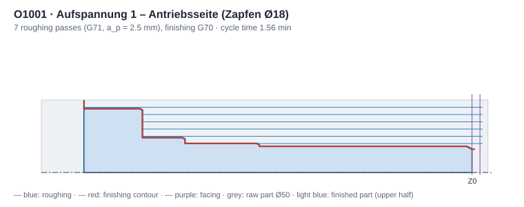
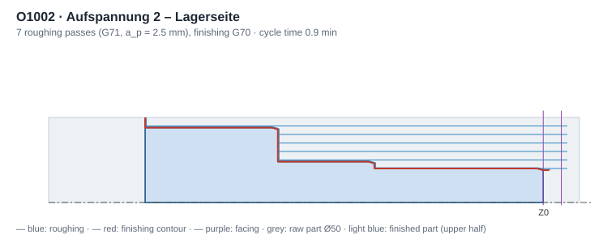

# CNC turning program and setup sheet: pinion shaft z = 20, m = 2

**Tools:** ISO/DIN 66025 programming (Fanuc dialect), cycle-time calculation, CAD from the spur-gear reducer project
**Author:** Assem Ryan · November 2026

## Task
The pinion shaft from my spur-gear reducer (42CrMo4+QT, raw part Ø50 × 110 mm) is turned on a 2-axis CNC lathe in two setups before gear hobbing. Deliverables: the NC programs, a setup sheet (Einrichteblatt), the toolpath check and the cycle time. The cycle time is compared with the main-time estimate from the process plan (Arbeitsplan).

## Setup sheet (Einrichteblatt)
| | Setup 1 – O1001 (drive side) | Setup 2 – O1002 (bearing side) |
|---|---|---|
| Clamping | 3-jaw chuck on raw Ø50, stick-out 80 mm | soft jaws on the Ø18 journal + live centre |
| Workpiece zero | finished end face, Z0 | finished end face, Z0 |
| Contour | Ø18 k6 × 40 (1 × 45° chamfer), Ø20 k6 × 14, Ø24 × 8, Ø44 h11 (gear blank) | Ø20 k6 × 14, Ø24 × 8, Ø44 h11 (overlap 2 mm) |
| T01 | CNMG 120408, facing and roughing, v_c = 180 m/min, f = 0.3 mm (facing 0.2), a_p = 2.5 mm | same |
| T03 | VNMG 160404, finishing, v_c = 220 m/min, f = 0.1 mm | same |
| Speed limit | G50 S3000 (constant cutting speed G96) | same |
| Coolant | emulsion (M08) | same |

Finishing allowance from G71: U = 0.4 mm (on diameter), W = 0.1 mm.

## NC programs
[O1001.nc](O1001.nc) and [O1002.nc](O1002.nc) contain:
* facing in two passes with G94;
* stock removal with the **G71** roughing cycle (contour N10–N20);
* finishing along the same contour with **G70**.

The contour is described once and used for both roughing and finishing. Diameter values are in X, feeds are per revolution (G99), and the cutting speed is constant (G96).

## Cycle time
To compute the cycle time, the cycles were expanded into single moves. Each roughing pass ends where the contour plus the finishing allowance is reached, and G71 finishes with a final pass along the offset contour. Times: cutting time from t = L / (f·n) with n = 1000·v_c / (π·d), limited to 3000 rpm and integrated along every move; rapid traverse at 15 m/min; 4 s per tool change.

| Setup | Roughing passes | Cutting | Rapid | Tool change | **Total** |
|---|---|---|---|---|---|
| O1001 | 7 | 1.36 min | 0.07 min | 0.13 min | **1.56 min** |
| O1002 | 7 | 0.73 min | 0.05 min | 0.13 min | **0.90 min** |
| **Both setups** | | **2.09 min** | | | **2.46 min** |

**Cross-check:** the process plan of the gear reducer estimated 1.97 min of main time for the same turning operations with simple formulas. The NC-based value of 2.09 min is 6 % higher. The difference comes from the approach and overrun distances, and from the smaller diameters, where the speed limit of 3000 rpm lowers the cutting speed. Set-up time and part handling are not included.

## What I would do next on the machine
* Check the clamping of setup 2 (soft jaws on the finished Ø18 journal) for concentricity of the bearing seats: target ≤ 0.01 mm run-out, otherwise turn between centres.
* Simulate the programs in the control or in CAM before the first part, then run the first part with the feed override at 50 %.
* Measure the k6 seats in process. If needed, use a separate finishing pass with tool-wear compensation.

---
### Kurzfassung (DE)
* **Aufgabe:** CNC-Drehprogramme (Fanuc, G94/G71/G70) und Einrichteblatt für die Ritzelwelle aus 42CrMo4+QT, in zwei Aufspannungen.
* **Hauptzeit:** 2,09 min aus dem NC-Programm, 2,46 min einschließlich Eilgang und Werkzeugwechsel. Die Abweichung zur Hauptzeit-Abschätzung im Arbeitsplan (1,97 min) beträgt 6 %.
