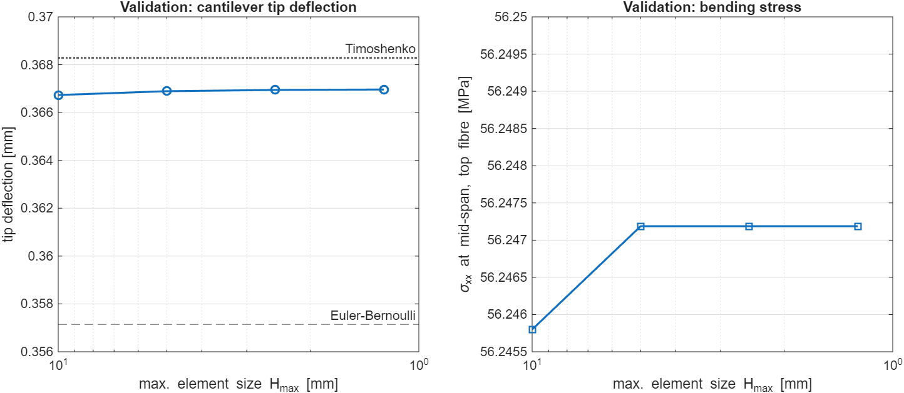
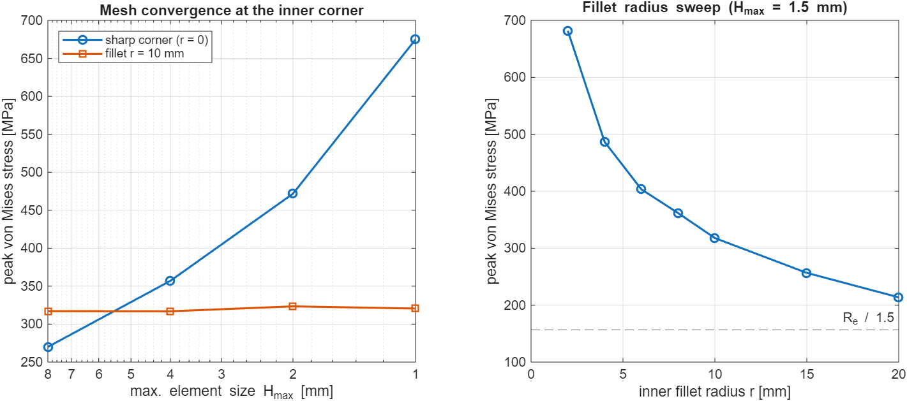
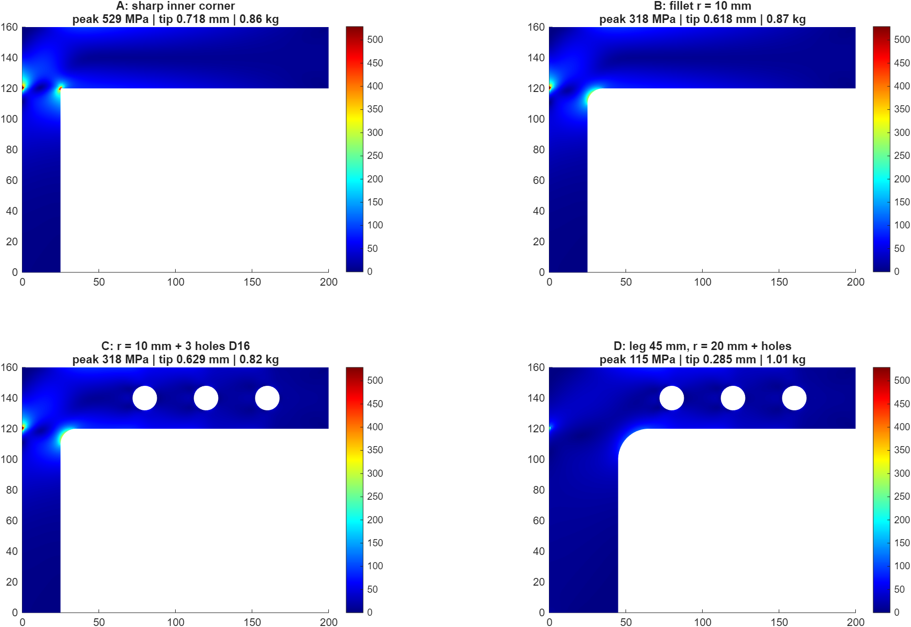

# FEM study of a steel L-bracket – validation, stress concentration and redesign

**Tools:** MATLAB R2025a, Partial Differential Equation Toolbox (2D plane stress, quadratic triangles)
**Author:** Assem Ryan · November 2026

## Problem
A wall bracket made of S235 steel plate (t = 10 mm) carries F = 1500 N at the end of a 200 mm arm.
The wall leg is bolted along 120 mm of its height (modelled as a fixed edge). Questions:
1. Does the FE model reproduce beam theory? (model validation)
2. How large is the stress at the inner corner, and how does the fillet radius change it?
3. Can the part be lightened without losing strength — and is the original design safe at all?

## Model
| Item | Value |
|---|---|
| Material | S235: E = 210 GPa, ν = 0.3, R_e = 235 MPa |
| Thickness / load | t = 10 mm, F = 1500 N as edge traction at x = 200 mm |
| Element type | quadratic triangles, plane stress, H_max = 1.5 mm (convergence studied) |
| Evaluation | von Mises stress; region x ≤ 5 mm excluded (end of the ideal clamp is an artificial singularity) |

## 1 · Validation against beam theory
Straight cantilever 200 × 40 mm, same load:

| | Tip deflection | σ_xx mid-span, top fibre |
|---|---|---|
| Euler–Bernoulli | 0.357 mm | 56.25 MPa |
| Timoshenko (with shear) | 0.368 mm | – |
| **FEM (H_max = 1.25 mm)** | **0.367 mm** (−0.4 % vs. Timoshenko) | **56.25 MPa** |

The deflection converges to the Timoshenko value because a 200/40 beam is short enough for shear deformation to matter (~3 %).

## 2 · Inner corner: singularity vs. fillet
* **Sharp corner:** the peak stress keeps rising with mesh refinement (270 → 357 → 472 → 675 MPa for H_max = 8 → 1 mm). This is a geometric singularity — the number has no physical meaning and must not be used for sizing.
* **Fillet r = 10 mm:** the peak converges (317–323 MPa over the same meshes).
* **Fillet sweep (H_max = 1.5 mm):** 682 MPa (r = 2) → 318 MPa (r = 10) → 214 MPa (r = 20). The r = 2 mm value is less well resolved (few elements on the arc).

## 3 · Design variants
| Variant | Peak von Mises | Tip deflection | Mass | Safety vs. R_e |
|---|---|---|---|---|
| A: sharp inner corner | 529 MPa* | 0.718 mm | 0.863 kg | – |
| B: fillet r = 10 mm | 318 MPa | 0.618 mm | 0.865 kg | 0.74 ✗ |
| C: B + 3 holes Ø16 on the arm neutral axis | 318 MPa | 0.629 mm | 0.818 kg | 0.74 ✗ |
| **D: leg 45 mm, fillet r = 20 mm + holes** | **115 MPa** | **0.285 mm** | **1.012 kg** | **2.05 ✓** |

\* mesh-dependent (singular), shown for comparison only.

## Findings
* The original geometry (25 mm leg) **yields under 1500 N**, even with a 10 mm fillet: the critical point is the leg-side end of the fillet, where the arm's bending moment is transferred into the leg.
* **Lightening holes on the neutral axis** remove 5.4 % mass and change the peak stress by < 0.1 % and the deflection by +1.8 % — they are worth it, but they do not solve the strength problem.
* Widening the leg to 45 mm and using r = 20 mm reduces the peak stress by 64 % and the deflection by 54 % compared with variant B, for +17 % mass, giving a safety factor of about 2 against yielding.

## Limitations
2D plane-stress model; linear-elastic material; ideal fixed edge instead of real bolts (no contact, no bolt preload); static load only — no fatigue assessment (for cyclic loads, the fillet would need a notch-fatigue check, e.g. FKM guideline); no buckling or weld check.

## Files
* `bracket_fem_study.m` – complete, reproducible script (geometry, mesh, solve, plots)
* `results.json` – all numerical results
* `figures/` – plots
