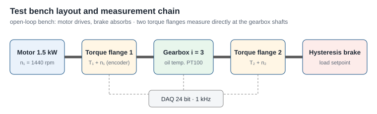
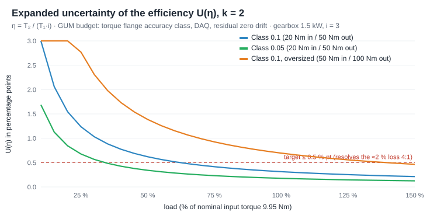

# Efficiency test bench for the spur-gear reducer: concept, measurement chain and uncertainty

**Tools:** GUM uncertainty analysis, sensor selection, test planning
**Author:** Assem Ryan · November 2026

## Task
The efficiency of my spur-gear reducer (1.5 kW, 1440 rpm, i = 3, design efficiency ≈ 98 %) is to be verified on a test bench. The questions:
* Which measurement chain is needed?
* How accurate is the measured efficiency?
* At which loads does the result actually mean something?

## Measurement principle
The motor drives the gearbox and a hysteresis brake absorbs the power. Two torque flanges with speed encoders measure directly at the input and output shafts.

Because the gear ratio is fixed by the tooth numbers (no slip), the efficiency is

**η = T₂ / (T₁ · i)**

so the speeds are not needed for η. They are recorded only as a plausibility check: n₂ = n₁ / i, which detects encoder faults. This removes two uncertainty sources from the budget.

## Uncertainty budget (GUM, k = 2)
Inputs:
* **Torque flange accuracy class:** e.g. 0.1 % of the nominal torque, treated as a rectangular distribution, so u = a / √3.
* **DAQ:** 0.02 % of reading.
* **Residual zero drift after taring at test temperature:** 0.04 % at full load, growing as 1/load.

At 100 % load with class 0.1 flanges (20 Nm input / 50 Nm output):

| Contribution | Relative standard uncertainty |
|---|---|
| Input torque T₁ (20 Nm flange at 9.95 Nm) | 0.116 % |
| Output torque T₂ (50 Nm flange at 29.25 Nm) | 0.099 % |
| Zero drift | 0.040 % |
| **Expanded U(η), k = 2** | **0.32 % → η = 98.0 % ± 0.3 %-pt** |

U(η) in percentage points:

| Load | Class 0.1 (20/50 Nm) | Class 0.05 (20/50 Nm) | Class 0.1, oversized (50/100 Nm) |
|---|---|---|---|
| 25 % | 1.26 | 0.69 | 2.83 |
| 50 % | 0.63 | 0.35 | 1.41 |
| 75 % | 0.42 | 0.24 | 0.94 |
| 100 % | 0.32 | 0.18 | 0.71 |
| 125 % | 0.26 | 0.15 | 0.57 |

**Findings**
* To resolve a loss of about 2 % with a ratio of 4 : 1, U(η) should be ≤ 0.5 percentage points. That needs ≥ 65 % load with class 0.1 flanges, or ≥ 35 % load with class 0.05.
* **Sensor sizing matters more than the accuracy class:** oversized flanges (50/100 Nm) only reach the target at 140 % load, even with the same class. The flange should be chosen close to the measured torque.
* At part load, efficiency values from this bench are only indicative. The report must state U(η) for every load point.

## Test procedure
| Step | Content |
|---|---|
| Run-in | 2 h at 50 % load, both directions, oil change afterwards |
| Warm-up | 100 % load until the oil sump temperature changes < 1 K in 10 min (≈ 60 °C) |
| Zero / tare | both flanges tared unloaded at test temperature |
| Load steps | 25 / 50 / 75 / 100 / 125 % of 9.95 Nm input torque at 1440 rpm, 5 min each |
| Recording | 1 kHz raw, 10 s averages: T₁, T₂, n₁, n₂, oil temperature, motor current |
| Repeat | 3 runs, rising and falling load (hysteresis check) |
| Evaluation | η = T₂ / (T₁·i) with U(η) per point; plausibility check n₂ = n₁ / i |

## Limitations
* This is a concept and uncertainty study; no measurements were taken.
* The sensor accuracy figures are typical catalogue classes, not a specific product.
* Churning losses depend strongly on oil level and temperature, so efficiency must always be reported together with the oil temperature.

---
### Kurzfassung (DE)
* **Prüfstand:** Wirkungsgrad-Prüfstand für das Stirnradgetriebe (Motor, 2 Drehmomentmessflansche, Hysteresebremse). Wirkungsgrad aus η = T₂/(T₁·i).
* **Messunsicherheit nach GUM:** bei Nennlast ±0,3 %-Punkte (k = 2).
* **Ergebnis:** Erst ab ca. 65 % Last (Klasse 0,1) ist der Wirkungsgrad aussagekräftig. Die Auslegung des Messflansch-Nennmoments ist wichtiger als die Genauigkeitsklasse.
