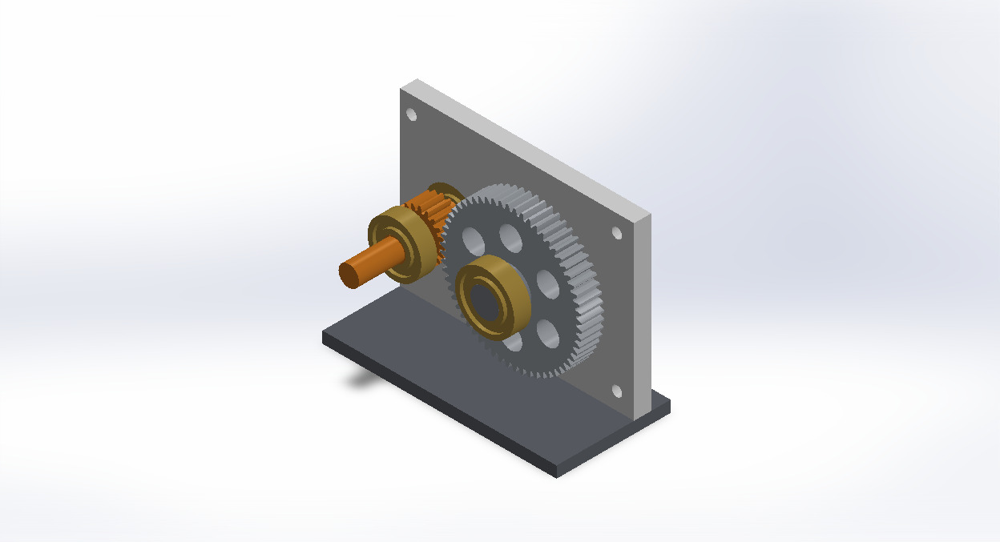
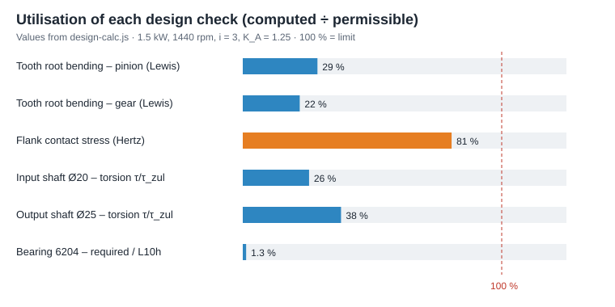
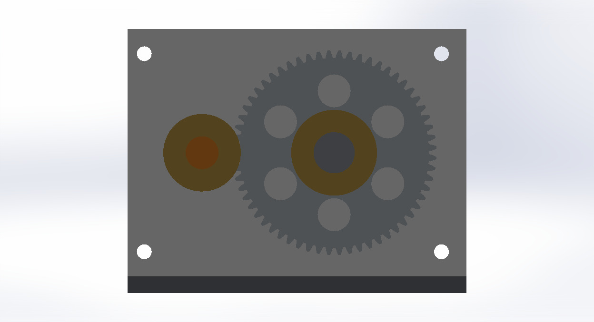
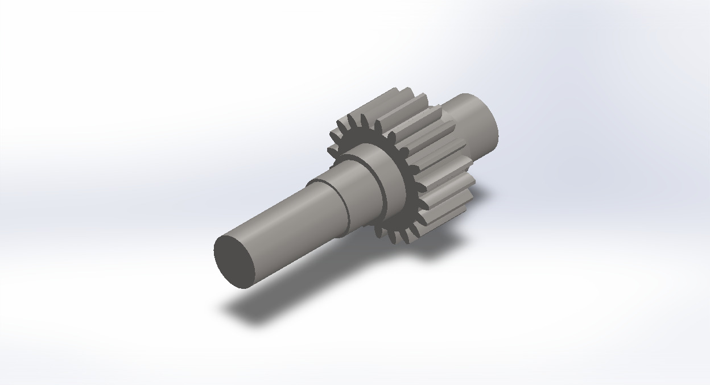
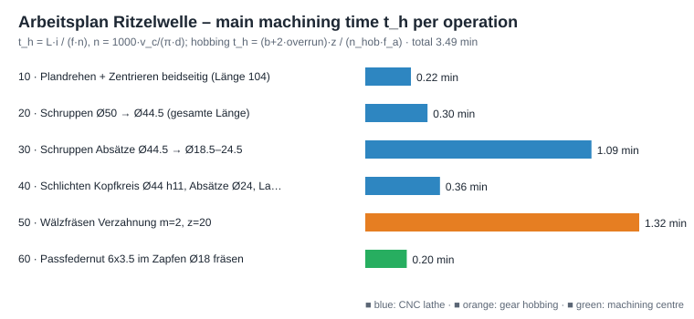

# Single-stage spur-gear reducer i = 3: design calculation, SOLIDWORKS model and process plan

**Tools:** SOLIDWORKS 2025 (Student Edition), driven through the SOLIDWORKS API (C#); Node.js for the calculation and figures
**Author:** Assem Ryan · November 2026

## Task
A 1.5 kW / 1440 rpm IEC motor drives a conveyor at about 480 rpm. The project designs a one-stage spur-gear reducer (Stirnradgetriebe) for this duty and takes it from the hand calculation to a checked 3D assembly, drawings and a manufacturing plan for the pinion shaft.

| Requirement / assumption | Value |
|---|---|
| Input power and speed | P = 1.5 kW, n₁ = 1440 rpm, so T₁ = 9.95 Nm |
| Ratio | i = 3 (z₁ = 20, z₂ = 60), so n₂ = 480 rpm and T₂ = 29.25 Nm (η = 0.98) |
| Gear data | m = 2 mm, α = 20°, b = 20 mm, a = 80 mm, backlash 0.1 mm |
| Material | 42CrMo4+QT (1.7225) gears and shafts; EN-GJL-250 walls; S235JR base plate |
| Application factor | K_A = 1.25 (electric motor, conveyor with moderate shocks) |
| Required bearing life | L₁₀h ≥ 20,000 h |

## 1 · Design calculation (`calc/design-calc.js`)
This is a preliminary sizing (Vorauslegung) with textbook methods: Lewis tooth-root bending with the Barth dynamic factor, Hertzian flank pressure in the simplified ISO 6336 form, torsion-based shaft sizing, and the ISO 281 basic bearing life.

| Check | Result | Permissible | Utilisation |
|---|---|---|---|
| Tooth-root bending, pinion | 72.1 MPa | 250 MPa | 29 % |
| Tooth-root bending, gear | 55.0 MPa | 250 MPa | 22 % |
| **Flank contact stress (Hertz)** | **524 MPa** | **650 MPa** | **81 % (S_H = 1.24)** |
| Input shaft Ø20, torsion | d_min = 12.7 mm | – | 26 % (τ) |
| Output shaft Ø25, torsion | d_min = 18.1 mm | – | 38 % (τ) |
| Bearings 6204 / 6205 | 1.5 M h / 6.1 M h | 20,000 h | ≈ 1 % |
| Transverse contact ratio ε_α | 1.67 | ≥ 1.2 | ✓ |

Further values: tangential force F_t = 497 N, pitch-line speed v = 3.0 m/s, K_v = 1.49.

**What the numbers say:** the flank (pitting) strength, not the tooth-root bending, limits this gear pair, at more than twice the bending utilisation. A smaller module would therefore not save much. To carry more power, the face width or the centre distance has to grow, or the gears have to be case-hardened (16MnCr5). The bearings are sized by the shaft diameter, not by the load, so their computed life is very high. This is typical for small, lightly loaded reducers.

## 2 · SOLIDWORKS model built through the API (`cad/BuildReducer.cs`)
The C# program connects to the running SOLIDWORKS session and builds everything from the calculated values:
* **Involute teeth from the equations:** the flank points are computed with the involute function inv α = tan α − α, with tooth thickness reduced for 0.1 mm backlash, then sketched and extruded. There is no Toolbox or library gear.
* Parts: pinion shaft z = 20, gear z = 60 with bore Ø30 and 6 lightening holes, output shaft, spacer sleeves, simplified 6204/6205 bearings, two cast-iron side walls with bearing bores, base plate. Materials come from the SOLIDWORKS DIN material library.
* **Assembly** at the exact calculated centre distance a = 80 mm. The gear is rotated by half a tooth pitch so the teeth mesh.
* **Interference detection** (SOLIDWORKS `InterferenceDetectionManager`). The first runs found real modelling errors (missing bearing bores, wrong part positions), which the check caught. The final assembly has **0 interferences**, including the meshing teeth.
* **Drawings:** A3 DIN sheet with first-angle projection (European standard), views and model dimensions created automatically, exported to PDF ([pinion shaft](drawings/Zeichnung_Ritzelwelle.pdf), [assembly](drawings/Zeichnung_Baugruppe.pdf)).

**Plausibility check of the CAD:** volumes reported by SOLIDWORKS against hand estimates:

| Part | SOLIDWORKS | Hand estimate | Difference |
|---|---|---|---|
| Gear z = 60 (with bore and holes) | 172.9 cm³ | ≈ 174.5 cm³ (pitch-circle disc − bore − holes) | −0.9 % |
| Pinion shaft | 50.6 cm³ | ≈ 51.3 cm³ (pitch disc + cylinders) | −1.3 % |
| Assembly mass | 10.2 kg | – | – |

The small differences are expected: the real tooth outline is not exactly the pitch-circle disc.

| | |
|---|---|
|  |  |

## 3 · Process plan (Arbeitsplan) for the pinion shaft
Raw part: Ø50 × 110 mm, 42CrMo4 delivered quenched and tempered. Main machining times are calculated with t_h = L·i / (f·n) and n = 1000·v_c / (π·d). For gear hobbing: t_h = (b + 2·overrun)·z / (n_hob·f_a).

| Op. | Operation | Machine | v_c [m/min] | f | n [rpm] | t_h [min] |
|---|---|---|---|---|---|---|
| 10 | Face both ends and centre-drill (length 104) | CNC lathe | 180 | 0.2 mm | 1146 | 0.22 |
| 20 | Rough turn Ø50 → Ø44.5 | CNC lathe | 180 | 0.3 mm | 1146 | 0.30 |
| 30 | Rough turn the steps Ø44.5 → Ø18.5–24.5 (5 passes) | CNC lathe | 180 | 0.3 mm | 1288 | 1.09 |
| 40 | Finish turn tip circle Ø44 h11, steps, bearing seats Ø20 k6, journal Ø18 k6 | CNC lathe | 220 | 0.1 mm | 2918 | 0.36 |
| 50 | Hob the teeth m = 2, z = 20 (Ø63 single-start hob) | Gear hobbing machine | 80 | 1.5 mm/rev | 404 | 1.32 |
| 60 | Mill keyway 6 × 3.5 in the journal (solid carbide end mill Ø6, z = 3) | Machining centre | 60 | 0.03 mm/tooth | 3183 | 0.20 |
| | **Total main machining time** | | | | | **3.49 min** |

These are main machining times only. Set-up, tool-change and idle times, which an MTM/REFA time study would add, are not included.

## Limitations
* This is a preliminary sizing, not a full DIN 3990 / ISO 6336 proof: no K_Hβ/K_Fβ load-distribution factors, no profile shift or tip relief, no fatigue/notch check of the shafts (e.g. per DIN 743), and no lubrication or heat-balance check.
* The tooth model has no root fillet (straight root lines). Bearings are simplified rings, not catalogue models. The keyway is in the process plan only, not in the 3D model.
* The housing is a simplified open frame (two walls plus base plate), not a closed oil-tight casing.
* SOLIDWORKS Student Edition: the CAD files open only in educational versions; the drawings carry the educational watermark.

## Files
`calc/` calculation and figure scripts with results.json · `cad/` API build program, build-log.json (masses, interference result), `SolidWorks_2025_files.zip` (parts, assembly, drawings) · `drawings/` PDF drawings · `figures/` images

---
### Kurzfassung (DE)
Auslegung eines einstufigen Stirnradgetriebes (1,5 kW, i = 3, m = 2, z = 20/60):
* **Vorauslegung:** Zahnfuß nach Lewis, Flankenpressung nach Hertz, Wellen auf Torsion, Lagerlebensdauer nach ISO 281. Die Flankenpressung ist mit 81 % Auslastung (S_H = 1,24) maßgebend.
* **SOLIDWORKS-Modell per API:** Evolventenverzahnung direkt aus der Evolventenfunktion berechnet, Baugruppe im Achsabstand a = 80 mm, Kollisionsprüfung mit 0 Kollisionen, DIN-A3-Zeichnungen in Projektionsmethode 1.
* **Arbeitsplan der Ritzelwelle:** Hauptzeiten aus Schnittdaten berechnet, gesamt 3,49 min.
