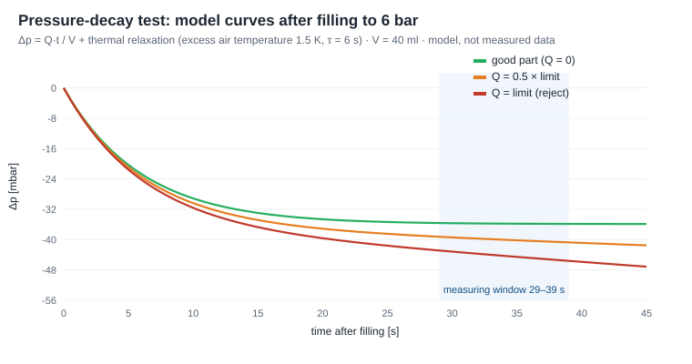

# End-of-line leak test for a threaded valve housing: pressure-decay test design

**Tools:** test design and physics model (ideal gas, thermal relaxation), measurement-system capability (MSA type 1), cycle-time planning
**Author:** Assem Ryan · November 2026

## Task
The threaded valve housing from my SolidWorks portfolio is to be leak-tested at the end of the line (100 % test) with compressed air. The questions:
* Which pressure drop separates good from leaky parts?
* How long must the test cycle be?
* Which pressure sensor is good enough?
* How many parts per hour can one station test?

## Assumptions
| Parameter | Value |
|---|---|
| Test pressure | 6 bar (gauge), i.e. 7013 mbar absolute |
| Test volume | 40 ml (valve cavity + fixture + lines; concept assumption) |
| Reject limit | Q = 1·10⁻² mbar·l/s (≈ 0.6 cm³/min at atmosphere) |
| Air heating after fast filling | ΔT₀ = 1.5 K, decaying with τ = 6 s (order of magnitude; to be measured on the real fixture) |
| Fill / vent time | 3 s / 2 s |

## Physics
* **Leak:** Q = V · dp/dt, so at the limit dp/dt = 1·10⁻² / 0.04 = **0.25 mbar/s**, i.e. 2.5 mbar in a 10 s window.
* **Temperature:** p ∝ T. A change of only **0.1 K changes the pressure by 2.4 mbar**, as much as the whole leak signal. Directly after filling, the temperature offset is worth 36 mbar.

So the test is not limited by the sensor but by **thermal stabilisation**.

## Test-cycle design
Criterion: the thermal drift inside the measuring window must be ≤ 10 % of the leak signal at the reject limit.

| Method | Measuring window | Settle time | Cycle time | Parts/hour |
|---|---|---|---|---|
| Absolute pressure decay | 10 s | 29 s | 44 s | 81 |
| Absolute pressure decay | 20 s | 25.5 s | 50.5 s | 71 |
| **Differential vs. a reference part (≈ 90 % thermal compensation)** | **10 s** | **15 s** | **30 s** | **120** |

The differential method compares the test part with a sealed, identical reference part that is filled at the same time. The common thermal effect largely cancels out. This saves 14 s per part (−32 % cycle time) and is the recommended solution for series production.

## Gauge capability
* The test signal band (0 to reject limit) is 2.5 mbar. For Cg = 0.2·T / (6·s) ≥ 1.33, the repeatability of the system must be s ≤ **0.063 mbar**. This has to be shown with a type 1 study: 25 measurements on a master part, plus one with a calibrated test leak at the limit.
* Sensor resolution of 0.1 mbar is 1/25 of the band, which is sufficient (rule: ≤ 1/10).
* The station needs a calibrated test leak (e.g. 1·10⁻² mbar·l/s) for the daily function check.

## Limitations
* This is a concept study with model curves, not measured data. Real τ and ΔT₀ depend on the fixture, the part mass and the fill speed, and must be measured before setting the parameters.
* The model is isothermal apart from the fill heating; part deformation (volume change) under pressure is not modelled.

---
### Kurzfassung (DE)
* **Prüfung:** Druckabfall-Dichtheitsprüfung (100 %-EOL-Prüfung) für das Ventilgehäuse, Grenzleckrate 1·10⁻² mbar·l/s.
* **Thermik dominiert:** 0,1 K entsprechen 2,4 mbar, so viel wie das gesamte Lecksignal.
* **Taktzeit:** 44 s (81 Teile/h) mit dem Absolutverfahren, 30 s (120 Teile/h) mit dem Differenzverfahren gegen ein Referenzteil.
* **Messmittelfähigkeit:** Wiederholpräzision s ≤ 0,063 mbar für Cg ≥ 1,33.
